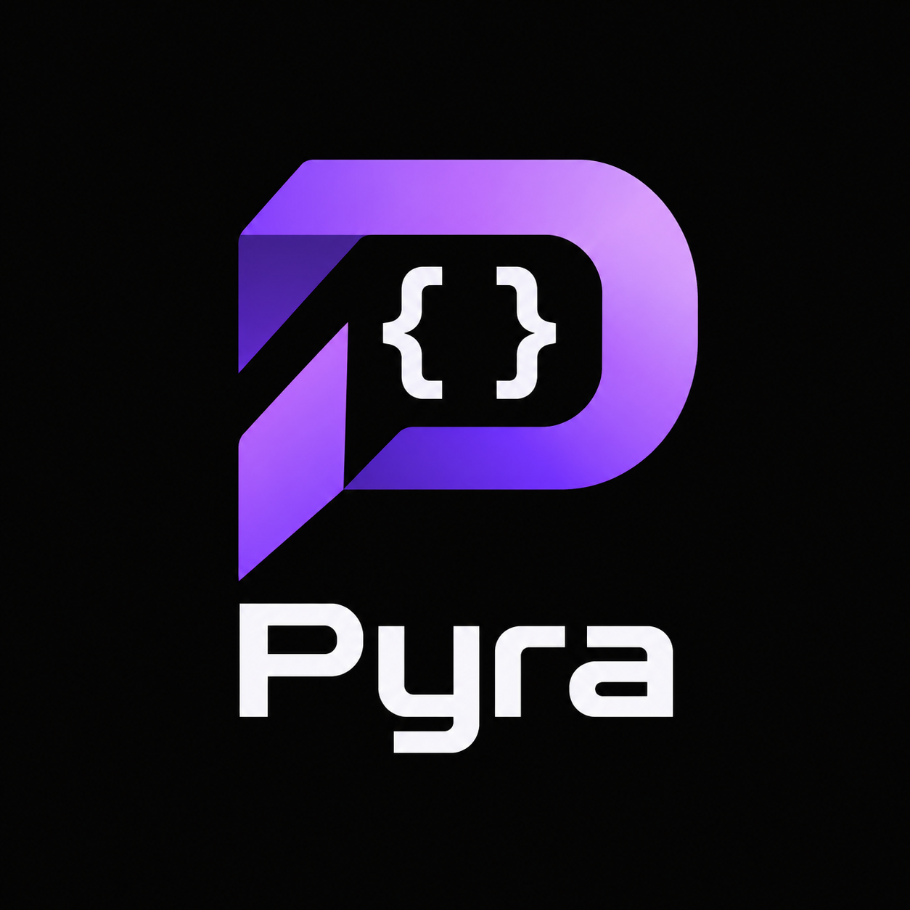

# Pyra

<p align="center">
  
</p>

Pyra is a small, brace-delimited, Python-inspired compiled language with semicolon-terminated simple statements. Its compiler is written in Rust and emits C++20 as a native backend; Clang or GCC then produces a standalone native executable. Compiled programs do not load or invoke the Pyra compiler, Python, or another interpreter.

The current implementation is an intentionally small first release. Its supported syntax, runtime model, build requirements, and known gaps are documented in [`docs/language-spec.md`](docs/language-spec.md), [`docs/architecture.md`](docs/architecture.md), and [`docs/installation.md`](docs/installation.md).

## Build and try it

Requirements: Rust/Cargo and a C++20 compiler (`clang++` by default; set `PYRA_CXX` to use another compiler).

```sh
git clone https://github.com/soy-charly/Pyra.git && cd Pyra
cargo build --release
cargo test
./target/release/pyra examples/factorial.pyra -o out/factorial
./out/factorial
```

The `pyra-language` VS Code extension source is in [`vscode-extension/`](vscode-extension/). It includes syntax highlighting, code snippets, completion, hover documentation, and signature help; see its README for packaging and installation.

Install the compiler to `/usr/local/bin/pyra` with `./scripts/install.sh`.

## Example

```pyra
def factorial(n) {
    if n <= 1 {
        return 1;
    }
    return n * factorial(n - 1);
}

for i in range(6) {
    print(factorial(i));
}
```

## Project layout

- `src/`: Rust lexer, parser, semantic checks, C++ code generator, and GCC-style CLI.
- `examples/`: runnable `.pyra` programs.
- `tests/`: compiler-to-native-executable integration tests.
- `docs/`: language, backend, CLI, and installation notes.
- `vscode-extension/`: TextMate grammar and CLI integration extension.
